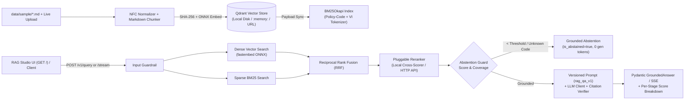
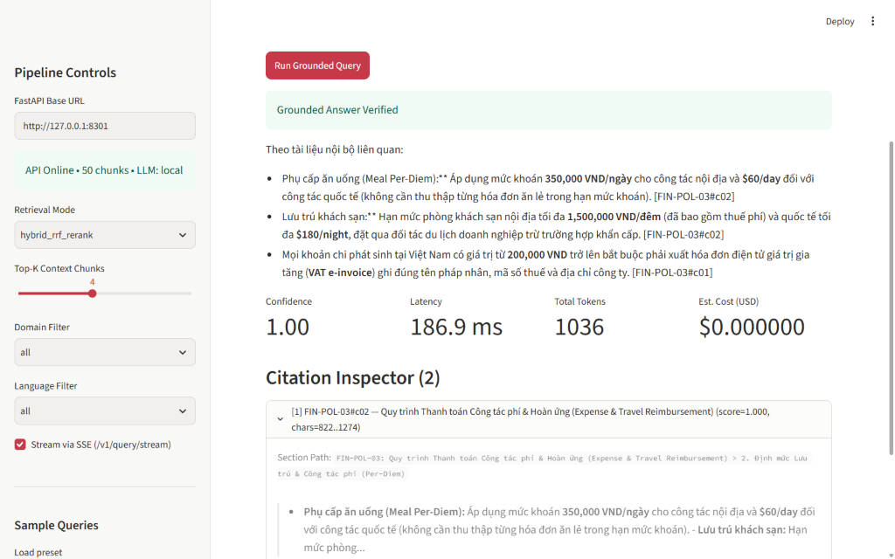
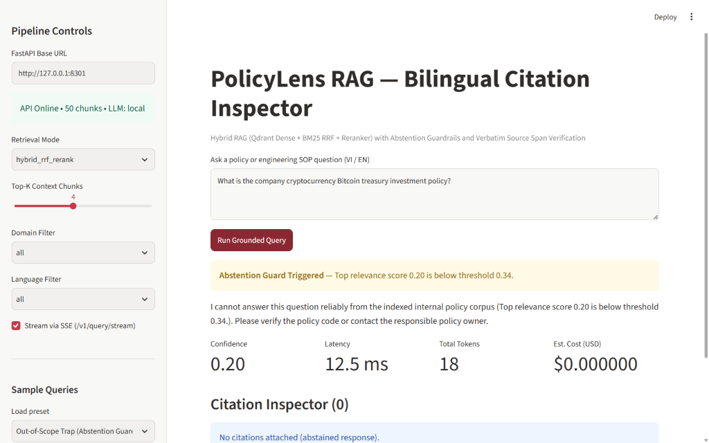
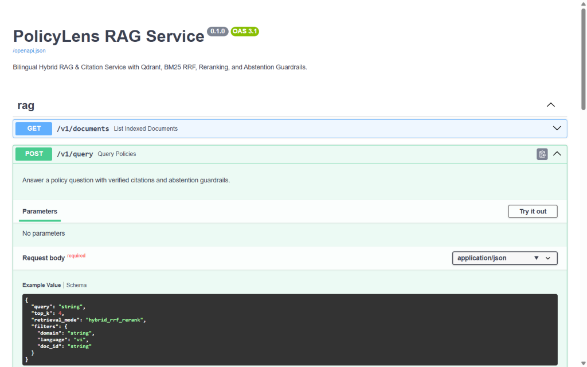

# PolicyLens RAG — Bilingual Hybrid RAG & Citation Service

> **One-sentence pitch:** Production-structured bilingual (Vietnamese/English) policy & SOP RAG service built with Python 3.13, FastAPI, Qdrant, quantized CPU ONNX multilingual embeddings (`fastembed`), BM25 Reciprocal Rank Fusion, pluggable reranking, two-layer hallucination abstention guardrails, a bespoke Swiss-minimalist RAG Studio Web UI, SSE streaming, and a Colab T4 Cross-Encoder fine-tuning notebook.

[](https://github.com/bachiep/policylens-rag/actions/workflows/ci.yml)


[](LICENSE)

---

## 1. Overview & Motivation

- **Problem:** Enterprise engineering teams and employees query internal security, HR, finance, and DevOps SOPs across mixed Vietnamese and English documents. Naive vector-only RAG pipelines frequently miss exact policy codes (`SEC-POL-04`, `FIN-POL-03`, `OPS-SLA-02`) and numeric thresholds (`99.95%`, `350,000 VND`, `lock_timeout = 3s`), truncate long sections, fabricate answers on out-of-scope questions, and lack quantitative retrieval benchmarks.
- **Solution:** PolicyLens separates document ingestion from online retrieval and grounded generation:
  1. Normalizes Unicode (`NFC`) and splits Markdown along heading hierarchies while preserving exact character spans (`char_start..char_end`).
  2. Combines **Quantized Multilingual CPU ONNX Dense Embeddings (`fastembed`)** in Qdrant + **Code-Aware BM25 (`rank-bm25`)** via **Reciprocal Rank Fusion (RRF)** and second-stage **Reranking**.
  3. Enforces **Dual-Layer Hallucination Control**: early retrieval abstention (`AbstentionGuard`) before generation plus strict `CitationSpan` chunk-ID verification after generation.
  4. Ships a **Swiss Enterprise RAG Studio Web Console (`GET /`)** with live SSE streaming, per-stage score bars (`Dense`, `BM25`, `RRF`, `Rerank`), source-span highlighting, live policy upload, and a benchmark explorer—running **zero-Docker and `$0` API cost out-of-the-box**, while switching seamlessly via `.env` to Qdrant Server, OpenAI, Gemini, Ollama, Jina, or Cohere.

---

## 2. System Architecture



### Key Technical Highlights (What to Inspect)
- **Quantized Multilingual CPU ONNX Embeddings (`src/policylens/retrieval/embeddings.py`):** Lazy-cached `FastEmbedMultilingualProvider` (`sentence-transformers/paraphrase-multilingual-MiniLM-L12-v2`, 384d quantized ONNX) executed non-blockingly via `asyncio.to_thread`, paired with automatic Qdrant collection dimension reconciliation (`src/policylens/retrieval/vector_store.py`) and deterministic `HashEmbeddingProvider` (`EMBEDDING_PROVIDER=hash`) for fast zero-download CI testing.
- **Markdown-Aware Recursive Chunker & Live Ingestion (`src/policylens/ingestion/`, `POST /v1/documents/upload`):** Preserves parent heading breadcrumbs (`section_path`) and exact verbatim character spans (`doc.body[char_start:char_end] == chunk.text`), backed by SHA-256 idempotent ingestion and live BM25 resynchronization.
- **Hybrid Retrieval & Policy-Code Preservation (`src/policylens/retrieval/`):** Custom tokenizer keeps hyphenated policy identifiers (`SEC-POL-04`), numeric limits (`350000`, `99.95%`), and Vietnamese diacritic tokens intact for `BM25Okapi`, fuses Top-K dense and sparse rankings via `reciprocal_rank_fusion`, and exposes `dense_score`, `bm25_score`, `rrf_score`, and `rerank_score` per citation.
- **Dual-Layer Abstention & Clean Markdown Synthesis (`src/policylens/retrieval/abstention.py`, `src/policylens/generation/llm_client.py`):** Evaluates top relevance score, non-generic query-term coverage, and referenced policy codes *before* calling the LLM, then cleans Markdown delimiter pairing and verifies every emitted `chunk_id` against retrieved candidates.
- **GPU Cross-Encoder Fine-Tuning & INT8 ONNX Export (`notebooks/colab_finetune_reranker_gpu.ipynb`):** Reproducible Google Colab / Kaggle T4 GPU notebook covering hard-negative mining from VI/EN queries, AMP `fp16` `CrossEncoder` fine-tuning, before/after `MRR@10` evaluation, and INT8 dynamic ONNX export for CPU serving.

---

## 3. Tech Stack

| Layer | Technology | Purpose |
| :--- | :--- | :--- |
| Language & Runtime | Python 3.13 | Type-safe async backend (`asyncio`, `unicodedata`) |
| API & Schemas | FastAPI, Uvicorn, Pydantic v2, `pydantic-settings` | REST APIs, SSE `/v1/query/stream`, `/health`, static studio |
| Embeddings & Vector/Sparse Search | `fastembed` (`onnxruntime`), `qdrant-client`, `rank-bm25`, `numpy` | Quantized multilingual ONNX cosine + BM25 sparse + RRF |
| HTTP & Cloud Providers | `httpx` | Async OpenAI / Gemini / Ollama / Jina / Cohere adapters |
| Web Consoles | Built-in Swiss RAG Studio (`GET /`) + optional Streamlit (`8501`) | Grounded Q&A, span highlighter, live ingestion, eval explorer |
| GPU Training Notebook | PyTorch AMP `fp16`, `sentence-transformers`, `optimum` | Colab/Kaggle T4 Cross-Encoder fine-tuning & INT8 ONNX export |
| Testing & Tooling | `pytest`, `pytest-asyncio`, `ruff`, Docker Compose | Deterministic `$0` CI test suite, linting, containerized stack |

---

## 4. Quick Start (Run Locally in < 3 Minutes)

### Prerequisites
- Python **3.11+** (verified on Python **3.13.7** Windows & Linux, no C++ build tools or local Docker required)
- Optional: Docker & Docker Compose for containerized Qdrant + API + UI

### Option A: Zero-Docker Local Run (Recommended for Quick Review)
```bash
git clone https://github.com/bachiep/policylens-rag.git
cd policylens-rag

python -m venv .venv
# Windows PowerShell: .\.venv\Scripts\Activate.ps1
# macOS/Linux: source .venv/bin/activate

pip install -e ".[dev,ui]"
cp .env.example .env

# 1. Ingest the 12 bilingual sample documents using fastembed ONNX into ./qdrant_storage
python -m scripts.ingest_sample

# 2. Start FastAPI service + RAG Studio Web UI on port 8301
uvicorn policylens.api.main:app --host 0.0.0.0 --port 8301

# 3. (Optional) Start secondary Streamlit Citation Inspector on port 8501
streamlit run src/policylens/ui/app.py --server.port 8501
```

### Option B: Docker Compose (Isolated Ports `8301` / `8501` / `6331`)
```bash
cp .env.example .env
docker compose up --build -d

# Ingest sample corpus into containerized Qdrant
docker compose exec api python -m scripts.ingest_sample
```

- **RAG Studio Web Console:** `http://localhost:8301/`
- **Swagger / OpenAPI Docs:** `http://localhost:8301/docs`
- **Streamlit Citation Inspector UI (optional):** `http://localhost:8501`
- **Sample `curl` Query:**
```bash
curl -X POST http://localhost:8301/v1/query \
  -H "Content-Type: application/json" \
  -d '{"query": "FIN-POL-03 định mức phụ cấp ăn uống công tác nội địa là bao nhiêu?", "retrieval_mode": "hybrid_rrf_rerank"}'
```

> **Live Cloud / Zero-Download Modes:** By default `.env.example` sets `EMBEDDING_PROVIDER=fastembed` (local quantized CPU ONNX) and `LLM_PROVIDER=local` so ingestion, serving, and evals run at `$0.00` API cost. Set `EMBEDDING_PROVIDER=hash` for offline/CI runs without model weights, or set `LLM_PROVIDER=gemini` / `openai` / `ollama` in `.env` to switch generation providers with zero code changes.

### Interactive UI & API Previews & 1-Click Collections

- **VS Code / IntelliJ HTTP Client:** [`docs/api-requests.http`](docs/api-requests.http)
- **Postman Collection v2.1:** [`docs/postman_collection.json`](docs/postman_collection.json) (covers `/health`, `/v1/documents`, `/v1/documents/upload`, `/v1/documents/{doc_id}/chunks`, `/v1/evals/latest`, bilingual queries, abstention traps, prompt-injection `400` check, and SSE streaming)

| Grounded Answer & Verbatim Citation Inspector | Abstention Guard (Out-of-Scope Rejection) | FastAPI OpenAPI Schema (`/docs`) |
| :---: | :---: | :---: |
|  |  |  |

---

## 5. Testing & Quantitative Evaluation (`evals/`)

### Run Linter & Automated Test Suite (`$0` API Cost)
```bash
ruff check .
EMBEDDING_PROVIDER=hash pytest -v
```
All **32** unit and integration tests execute deterministically with mock HTTP transports (and in-memory Qdrant)—covering Unicode NFC normalization, chunker character-span invariants, SHA-256 idempotent ingestion, `FastEmbedMultilingualProvider` lazy async loading & dimension mismatch recovery, BM25 code tokenization, RRF fusion, Markdown synthesis cleanup, live upload/chunk/eval endpoints, citation hallucination filtering, SSE streaming, and benchmark release gates.

### Run 35-Query Quantitative Evaluation Harness
```bash
python -m evals.run_eval
```

Measured output from `evals/results/benchmark_report.md` across `evals/dataset.jsonl` (**35 queries**: 28 bilingual in-scope policy/SOP/cross-lingual queries + 7 out-of-scope & fake-code abstention traps, using **`fastembed` quantized CPU ONNX `sentence-transformers/paraphrase-multilingual-MiniLM-L12-v2`**):

| Configuration | HitRate@5 | Recall@5 | MRR@10 | CitationPrecision | AbstentionAcc | p50 (ms) | p95 (ms) | Est. Cloud $/1k req |
| :--- | :---: | :---: | :---: | :---: | :---: | :---: | :---: | :---: |
| `dense_only` | 0.8214 | 0.8036 | 0.6009 | 0.5536 | 0.6857 | 60.02 | 115.92 | $0.1051 |
| `hybrid_rrf` | 0.9643 | 0.9643 | 0.8152 | 0.8036 | 0.8857 | 93.03 | 170.41 | $0.1509 |
| `hybrid_rrf_rerank` | 1.0000 | 1.0000 | 0.9821 | 0.9583 | 1.0000 | 88.72 | 163.43 | $0.1825 |

**Key Findings:**
1. Pure multilingual dense retrieval (`dense_only`, `paraphrase-multilingual-MiniLM-L12-v2`) achieves `0.8214` `HitRate@5` and `0.6009` `MRR@10` due to missed exact policy codes (`SEC-POL-04`, `FIN-POL-03`) and 128-token chunk truncation.
2. Fusing code-preserving BM25 with ONNX dense vectors (`hybrid_rrf`) lifts `HitRate@5` (`0.8214 -> 0.9643`), `Recall@5` (`0.8036 -> 0.9643`), and `MRR@10` (`0.6009 -> 0.8152`).
3. Adding second-stage reranking (`hybrid_rrf_rerank`) pushes `HitRate@5` & `Recall@5` to `1.0000`, `MRR@10` to `0.9821`, `CitationPrecision` to `0.9583`, and `AbstentionAcc` to `1.0000` (`7/7` out-of-scope traps blocked, `0` false abstentions) at `88.72 ms` median CPU latency.
4. Full JSON, per-query diagnostic, and Markdown artifacts are saved to `evals/results/` and rendered live in Tab 3 of the RAG Studio console (`/v1/evals/latest`).

---

## 6. Project Structure

```text
policylens-rag/
├── data/sample/                 # 12 bilingual (VI/EN) corporate Security, HR/Finance & Engineering SOPs
├── evals/
│   ├── dataset.jsonl            # 35 golden queries (28 in-scope + 7 out-of-scope traps)
│   ├── run_eval.py              # Automated 3-mode ONNX/hash evaluation runner
│   └── results/                 # benchmark_summary.json, per_query_results.json, benchmark_report.md
├── notebooks/
│   └── colab_finetune_reranker_gpu.ipynb  # T4 GPU Cross-Encoder fine-tuning & INT8 ONNX export
├── scripts/
│   └── ingest_sample.py         # Idempotent CLI ingestion entrypoint
├── src/policylens/
│   ├── config.py                # Pydantic Settings (.env)
│   ├── ingestion/               # NFC normalizer, Markdown chunker, SHA-256 pipeline
│   ├── retrieval/               # FastEmbed ONNX & Hash embedders, BM25, Qdrant, RRF, reranker, abstention
│   ├── prompts/                 # Versioned prompt templates (rag_qa_v1.py)
│   ├── generation/              # Pydantic schemas, LLM clients, Markdown cleaner, citation verifier, SSE
│   ├── api/                     # FastAPI app, GET / Studio UI, /health, /v1/* REST & SSE endpoints
│   └── ui/
│       ├── static/index.html    # Bespoke Swiss Enterprise RAG Studio web console
│       └── app.py               # Optional Streamlit Citation Inspector (port 8501)
├── tests/                       # 32 deterministic unit & integration tests
├── Dockerfile
├── docker-compose.yml
└── pyproject.toml
```

---

## 7. Tradeoffs & Production Roadmap

- **Single-process local Qdrant lock:** Default zero-Docker mode (`QdrantClient(path="./qdrant_storage")`) uses a file lock suitable for single-instance local development; switching `QDRANT_URL=http://localhost:6331` enables concurrent multi-worker API deployments against Qdrant Server.
- **BM25 scale ceiling:** In-memory `BM25Okapi` syncs cleanly from Qdrant payloads for hundreds/thousands of internal policy chunks (<10 ms startup rebuild). At 100k+ chunks, migrating sparse retrieval to Qdrant native sparse vectors (SPLADE / BM25 server-side) avoids loading full corpus text into API memory.
- **CPU Cross-Encoder serving:** `notebooks/colab_finetune_reranker_gpu.ipynb` trains a domain-adapted multilingual Cross-Encoder on T4 GPU and quantizes it to INT8 ONNX (`model_int8.onnx`) for sub-50 ms CPU reranking without shipping PyTorch in the production API container.
