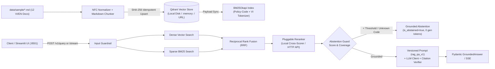

# PolicyLens RAG — Bilingual Hybrid RAG & Citation Service

> **One-sentence pitch:** Production-structured bilingual (Vietnamese/English) policy & SOP RAG service built with Python 3.13, FastAPI, Qdrant, BM25 Reciprocal Rank Fusion, pluggable reranking, two-layer hallucination abstention guardrails, SSE streaming, and a reproducible 35-query evaluation harness.

[](https://github.com/bachiep/policylens-rag/actions/workflows/ci.yml)


[](LICENSE)

---

## 1. Overview & Motivation

- **Problem:** Enterprise engineering teams and employees query internal security, HR, finance, and DevOps SOPs across mixed Vietnamese and English documents. Naive vector-only RAG pipelines frequently miss exact policy codes (`SEC-POL-04`, `FIN-POL-03`, `OPS-SLA-02`) and numeric thresholds (`99.95%`, `350,000 VND`, `lock_timeout = 3s`), fabricate answers on out-of-scope questions, and lack quantitative retrieval benchmarks.
- **Solution:** PolicyLens separates offline document ingestion from online retrieval and grounded generation:
  1. Normalizes Unicode (`NFC`) and splits Markdown along heading hierarchies while preserving exact character spans (`char_start..char_end`).
  2. Combines **Qdrant Dense Vector Search** + **Code-Aware BM25 (`rank-bm25`)** via **Reciprocal Rank Fusion (RRF)** and second-stage **Reranking**.
  3. Enforces **Dual-Layer Hallucination Control**: early retrieval abstention (`AbstentionGuard`) before generation plus strict `CitationSpan` chunk-ID verification after generation.
  4. Runs completely **zero-Docker and `$0` API cost out-of-the-box** using local Qdrant storage + deterministic local embeddings/extractive synthesis, while switching seamlessly via `.env` to Qdrant Server, OpenAI, Gemini, Ollama, Jina, or Cohere.

---

## 2. System Architecture



### Key Technical Highlights (What to Inspect)
- **Markdown-Aware Recursive Chunker (`src/policylens/ingestion/chunker.py`):** Preserves parent heading breadcrumbs (`section_path`) and exact verbatim character spans (`doc.body[char_start:char_end] == chunk.text`), backed by SHA-256 idempotent ingestion (`src/policylens/ingestion/pipeline.py`).
- **Hybrid Retrieval & Policy-Code Preservation (`src/policylens/retrieval/`):** Custom tokenizer keeps hyphenated policy identifiers (`SEC-POL-04`), numeric limits (`350000`, `99.95%`), and Vietnamese diacritic tokens intact for `BM25Okapi`, then fuses Top-K dense and sparse rankings via `reciprocal_rank_fusion`.
- **Dual-Layer Abstention & Citation Verification (`src/policylens/retrieval/abstention.py`, `src/policylens/generation/service.py`):** Evaluates top relevance score, non-generic query-term coverage, and referenced policy codes *before* calling the LLM, then verifies every emitted `chunk_id` against retrieved chunks to drop fabricated citations.
- **Versioned Prompts & Resilient LLM Adapters (`src/policylens/prompts/rag_qa_v1.py`, `src/policylens/generation/llm_client.py`):** Keeps prompts decoupled from FastAPI routes, enforces Pydantic v2 structured output, and implements bounded exponential-backoff retries via `httpx.AsyncClient`.

---

## 3. Tech Stack

| Layer | Technology | Purpose |
| :--- | :--- | :--- |
| Language & Runtime | Python 3.13 | Type-safe async backend (`asyncio`, `unicodedata`) |
| API & Schemas | FastAPI, Uvicorn, Pydantic v2, `pydantic-settings` | REST `/v1/query`, SSE `/v1/query/stream`, `/health`, config |
| Vector & Sparse Search | `qdrant-client` (local/URL), `rank-bm25`, `numpy` | Dense cosine + BM25 sparse retrieval + RRF |
| HTTP & Providers | `httpx` | Async OpenAI / Gemini / Ollama / Jina / Cohere adapters |
| Demo UI | Streamlit (`8501`) | Interactive Citation Inspector with SSE streaming |
| Testing & Tooling | `pytest`, `pytest-asyncio`, `ruff`, Docker Compose | Deterministic `$0` test suite, linting, containerized stack |

---

## 4. Quick Start (Run Locally in < 3 Minutes)

### Prerequisites
- Python **3.11+** (verified on Python **3.13.7** Windows & Linux, no C++ build tools or local Docker required)
- Optional: Docker & Docker Compose for containerized Qdrant + API + UI

### Option A: Zero-Docker Local Run (Recommended for Quick Review)
```bash
git clone https://github.com/bachiep/policylens-rag.git
cd policylens-rag

python -m venv .venv
# Windows PowerShell: .\.venv\Scripts\Activate.ps1
# macOS/Linux: source .venv/bin/activate

pip install -e ".[dev,ui]"
cp .env.example .env

# 1. Ingest the 12 bilingual sample documents into ./qdrant_storage
python -m scripts.ingest_sample

# 2. Start FastAPI service on port 8301
uvicorn policylens.api.main:app --host 0.0.0.0 --port 8301

# 3. (In a second terminal) Start Streamlit Citation Inspector on port 8501
streamlit run src/policylens/ui/app.py --server.port 8501
```

### Option B: Docker Compose (Isolated Ports `8301` / `8501` / `6331`)
```bash
cp .env.example .env
docker compose up --build -d

# Ingest sample corpus into containerized Qdrant
docker compose exec api python -m scripts.ingest_sample
```

- **Swagger / OpenAPI Docs:** `http://localhost:8301/docs`
- **Streamlit Citation Inspector UI:** `http://localhost:8501`
- **Sample `curl` Query:**
```bash
curl -X POST http://localhost:8301/v1/query \
  -H "Content-Type: application/json" \
  -d '{"query": "FIN-POL-03 định mức phụ cấp ăn uống công tác nội địa là bao nhiêu?", "retrieval_mode": "hybrid_rrf_rerank"}'
```

> **Live Cloud / Local LLM Configuration:** By default `.env.example` sets `EMBEDDING_PROVIDER=local` and `LLM_PROVIDER=local` so ingestion, API serving, tests, and evals run at `$0.00` API cost. Set `LLM_PROVIDER=gemini` (with `GEMINI_API_KEY`) or `LLM_PROVIDER=openai` / `ollama` (with `LLM_API_KEY` / `LLM_BASE_URL`) in `.env` to switch providers with zero code changes.

### Interactive UI & API Previews & 1-Click Collections

- **VS Code / IntelliJ HTTP Client:** [`docs/api-requests.http`](docs/api-requests.http)
- **Postman Collection v2.1:** [`docs/postman_collection.json`](docs/postman_collection.json) (covers `/health`, `/v1/documents`, bilingual `FIN-POL-03` & `HR-POL-01` queries, abstention traps, prompt-injection `400` check, and SSE streaming)

| Grounded Answer & Verbatim Citation Inspector | Abstention Guard (Out-of-Scope Rejection) | FastAPI OpenAPI Schema (`/docs`) |
| :---: | :---: | :---: |
|  |  |  |

---

## 5. Testing & Quantitative Evaluation (`evals/`)

### Run Linter & Automated Test Suite (`$0` API Cost)
```bash
ruff check .
pytest -v
```
All **25** unit and integration tests execute deterministically in memory (`qdrant_path=":memory:"`) with mock HTTP transports—covering Unicode NFC normalization, chunker character-span invariants, SHA-256 idempotent ingestion, BM25 code tokenization, RRF fusion, HTTP reranker/LLM retries, citation hallucination filtering, SSE streaming, and benchmark release gates.

### Run 35-Query Quantitative Evaluation Harness
```bash
python -m evals.run_eval
```

Measured output from `evals/results/benchmark_report.md` across `evals/dataset.jsonl` (**35 queries**: 28 bilingual in-scope policy/SOP/cross-lingual queries + 7 out-of-scope & fake-code abstention traps, offline deterministic baseline):

| Configuration | HitRate@5 | Recall@5 | MRR@10 | CitationPrecision | AbstentionAcc | p50 (ms) | p95 (ms) | Est. Cloud $/1k req |
| :--- | :---: | :---: | :---: | :---: | :---: | :---: | :---: | :---: |
| `dense_only` | 1.0000 | 0.9643 | 0.9345 | 0.8393 | 0.9143 | 4.81 | 6.70 | $0.1577 |
| `hybrid_rrf` | 1.0000 | 1.0000 | 0.9583 | 0.9107 | 0.9714 | 6.41 | 9.01 | $0.1731 |
| `hybrid_rrf_rerank` | 1.0000 | 1.0000 | 0.9821 | 0.9583 | 1.0000 | 27.70 | 35.93 | $0.1778 |

**Key Findings:**
1. Fusing sparse BM25 with dense search (`hybrid_rrf`) lifts `Recall@5` from `0.9643` to `1.0000` and eliminates false abstentions on exact policy-code queries.
2. Adding second-stage reranking (`hybrid_rrf_rerank`) pushes `MRR@10` to `0.9821`, raises `CitationPrecision` to `0.9583`, and achieves `1.0000` `AbstentionAcc` (`7/7` out-of-scope traps blocked, `0` false abstentions on the 28 in-scope queries).
3. Generated JSON & Markdown artifacts are saved to `evals/results/benchmark_summary.json` and `evals/results/benchmark_report.md`.

---

## 6. Project Structure

```text
policylens-rag/
├── data/sample/                 # 12 bilingual (VI/EN) corporate Security, HR/Finance & Engineering SOPs
├── evals/
│   ├── dataset.jsonl            # 35 golden queries (28 in-scope + 7 out-of-scope traps)
│   ├── run_eval.py              # Automated 3-mode evaluation runner
│   └── results/                 # Generated benchmark_summary.json & benchmark_report.md
├── scripts/
│   └── ingest_sample.py         # Idempotent CLI ingestion entrypoint
├── src/policylens/
│   ├── config.py                # Pydantic Settings (.env)
│   ├── ingestion/               # NFC normalizer, Markdown chunker, SHA-256 pipeline
│   ├── retrieval/               # Embeddings, BM25, Qdrant store, RRF, reranker, abstention guard
│   ├── prompts/                 # Versioned prompt templates (rag_qa_v1.py)
│   ├── generation/              # Pydantic schemas, LLM clients, citation verifier, SSE service
│   ├── api/                     # FastAPI app, lifespan, /health, /v1/documents, /v1/query(/stream)
│   └── ui/                      # Streamlit Citation Inspector (port 8501)
├── tests/                       # 25 deterministic unit & integration tests
├── Dockerfile
├── docker-compose.yml
└── pyproject.toml
```

---

## 7. Tradeoffs & Production Roadmap

- **Single-process local Qdrant lock:** Default zero-Docker mode (`QdrantClient(path="./qdrant_storage")`) uses a file lock suitable for single-instance local development; switching `QDRANT_URL=http://localhost:6331` enables concurrent multi-worker API deployments against Qdrant Server.
- **BM25 scale ceiling:** In-memory `BM25Okapi` syncs cleanly from Qdrant payloads for hundreds/thousands of internal policy chunks (<10 ms startup rebuild). At 100k+ chunks, migrating sparse retrieval to Qdrant native sparse vectors (SPLADE / BM25 server-side) avoids loading full corpus text into API memory.
- **Cross-encoder & LLM evaluation:** Offline deterministic scorers enable zero-cost CI regression testing; pairing `hybrid_rrf_rerank` with a multilingual cross-encoder (e.g., `bge-reranker-v2-m3`) and LLM-as-a-judge faithfulness checks extends coverage for subtle paraphrase conflicts.
